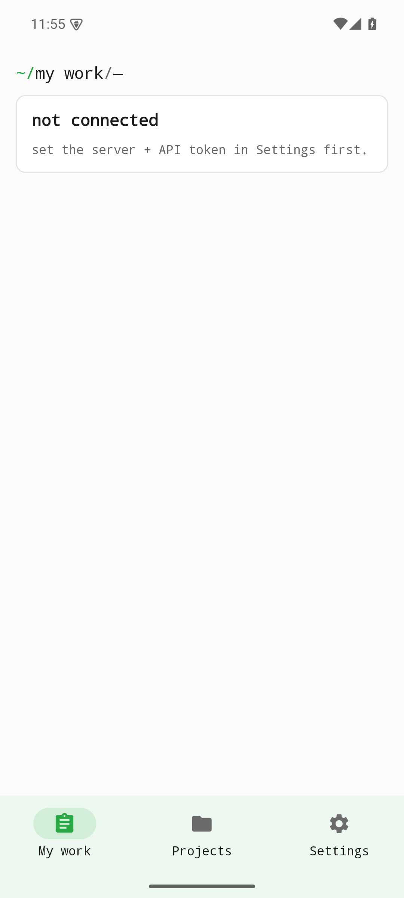
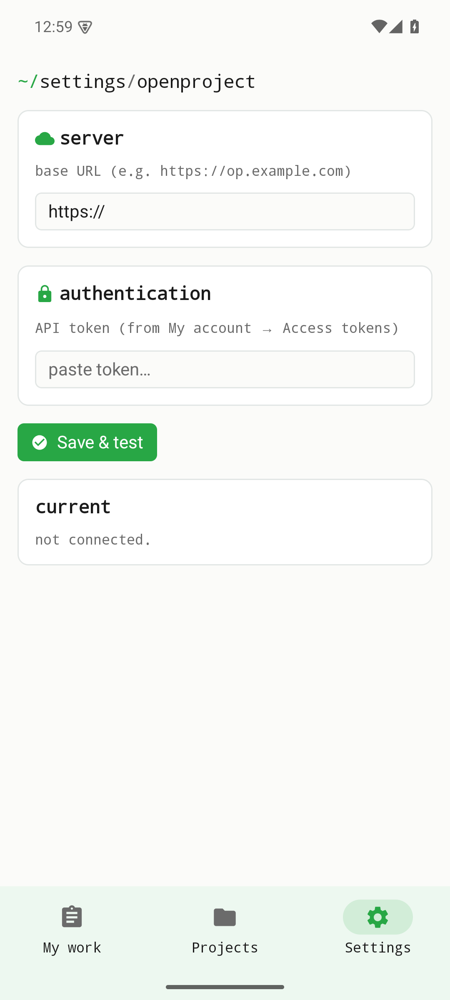

OpenProject-Projekte und Arbeitspakete mit dem eigenen Serverkonto durchsuchen. Erstellen, Bearbeiten und vollständige Seitennavigation sind noch nicht umgesetzt.

Diese Seite beschreibt den Quellstand vom Oktober 2026. Die Änderungen sind unveröffentlicht und nicht Teil älterer Entwicklungsreleases. Lokale Prüfungen ersetzen keine Geräte-, Live-Server- oder Store-Abnahme.

[Current status / Aktueller Stand / État actuel](../current-status.qmd)

Historische Bildschirmfotos aus v0.1.0; sie belegen keine Prüfung des aktuellen Quellstands.

{width=320}

{width=320}
