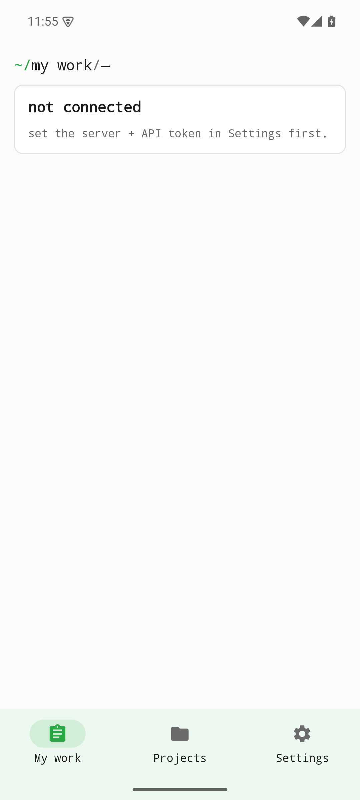
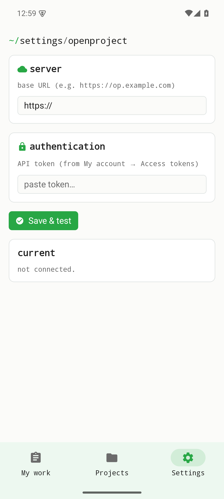

Consulter les projets et lots de travaux OpenProject avec votre compte serveur. La création, la modification et la pagination complète restent à développer.

Cette page décrit les sources d’octobre 2026. Ces modifications ne sont pas publiées et ne figurent pas dans les anciennes versions de développement. Les contrôles locaux ne remplacent pas la validation sur appareil, serveur réel ou boutique.

[Current status / Aktueller Stand / État actuel](../current-status.qmd)

Captures historiques de v0.1.0 ; elles ne constituent pas une validation de la version actuelle.

{width=320}

{width=320}
